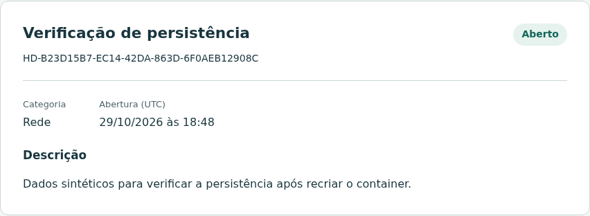

# HelpDesk: entrega da Sprint 1

Disciplina: Laboratório de Engenharia de Software\
Integrante: Leandro Pinzon Filho | Desenvolvimento individual\
Papel principal: Tech Lead | Entrega: 29/10/2026\
Repositório: <https://github.com/Lfijho/chamadosLES>

## 1. Identificação e objetivo

O projeto HelpDesk, Sistema de Controle de Chamados de TI, busca centralizar solicitações de suporte. Quando os pedidos ficam dispersos, o registro dos problemas e o acompanhamento do atendimento se tornam mais difíceis. O sistema organiza a abertura e, nas próximas Sprints, a consulta e o atendimento dos chamados.

O solicitante registra problemas e poderá acompanhar os próprios chamados. O técnico poderá consultar os chamados e conduzir o atendimento. Nesta Sprint, o solicitante abre chamados; o técnico acessa uma página inicial com o escopo futuro e o quadro de tarefas do desenvolvimento.

## 2. Equipe e responsabilidades

| Integrante | Responsabilidade principal | Atividades acumuladas |
|---|---|---|
| Leandro Pinzon Filho | Tech Lead | Requisitos, planejamento, arquitetura, desenvolvimento, testes, infraestrutura, documentação e apresentação |

O desenvolvimento é individual. Tech Lead identifica a responsabilidade técnica do projeto; não é um papel oficial do SCRUM. A organização utiliza backlog versionado, planejamento por Sprint, acompanhamento no Kanban e revisão por testes e inspeção. O histórico Git registra os blocos de trabalho e suas verificações.

A retrospectiva prevista no planejamento não tem ata ou registro formal confirmado nas fontes consultadas. Não se declara uma equipe SCRUM completa nem a realização de cerimônias sem evidência.

## 3. Escopo do projeto e da Sprint 1

| Código | Funcionalidade | Sprint |
|---|---|---|
| RF01 | Autenticar usuários | 1 |
| RF02 | Abrir chamado | 1 |
| RF03 | Consultar chamados com filtros e permissões | 2 |
| RF04 | Atualizar prioridade, status e solução | 2 |
| RF05 | Registrar e consultar histórico | 3 |
| RF06 | Consultar indicadores por status e prioridade | 3 |

A Sprint 1 entrega login e logout, perfis, proteção das rotas, abertura persistente de chamados e confirmação privada com protocolo. Também entrega o ambiente Docker, testes e documentação UML.

O Kanban é uma ferramenta auxiliar de acompanhamento do desenvolvimento, exclusiva do técnico. Suas colunas representam tarefas acadêmicas, não estados de chamados. A consulta de chamados pelo técnico, os filtros e a gestão do atendimento permanecem para a Sprint 2. Histórico e indicadores ficam para a Sprint 3.

<!-- pagebreak -->

## 4. Requisitos e regras de negócio

### 4.1. Requisitos funcionais entregues

| ID | Descrição implementada | Verificação |
|---|---|---|
| RF01 | Login com e-mail e senha para solicitante e técnico; logout por POST; sessão e permissões verificadas no servidor | Testes de login válido/inválido, expiração, revogação, redirecionamento e rotas privadas |
| RF02 | Solicitante autenticado abre chamado e recebe protocolo e resumo; confirmação acessível somente ao autor | Testes de criação, validação, autoria, status, UTC, escape e acesso de outro usuário |

### 4.2. Regras de negócio implementadas

| ID | Regra |
|---|---|
| RN01 | E-mail obrigatório, válido, até 254 caracteres, com espaços externos removidos e letras normalizadas para minúsculas. Senha obrigatória, até 128 caracteres. Credenciais incorretas recebem mensagem genérica |
| RN02 | Título de 5 a 120 caracteres e descrição de 10 a 5.000, após remover espaços externos. Categoria obrigatória: Hardware, Software, Rede, Acessos ou Outros |
| RN03 | O servidor define o solicitante a partir da sessão, gera UUID v4 e protocolo HD-, atribui status Aberto e registra abertura UTC. Campos extras do cliente não alteram esses valores |
| RN04 | Somente solicitante abre chamados. Técnico recebe 403. Na confirmação, chamado ausente ou de outro solicitante retorna 404; acesso anônimo exige login |
| RN05 | Após salvar, o servidor responde 303 para um GET de confirmação. Atualizar essa página não repete o envio. Um novo envio explícito pode criar outro chamado |
| RN06 | Apenas técnico consulta e move tarefas do Kanban. A sincronização preserva colunas existentes e tarefas extras; o seed não redefine senhas |

### 4.3. Requisitos não funcionais verificados

Os identificadores abaixo mantêm a referência usada em `docs/sprint-1.md`.

| ID | Condição atendida | Verificação atual |
|---|---|---|
| RNF01/RNF02 | Compose prepara a aplicação; Gunicorn sem debug executa como UID/GID 10001 | Build, inicialização isolada, `id` e saúde HTTP |
| RNF03/RNF05 | Senhas com scrypt; chave aleatória persistida; cookie HttpOnly/SameSite=Lax; sessão limitada a 8 horas no servidor | Código, testes de hash, chave, cookie e expiração |
| RNF04/RNF06 | CSRF nos POSTs, escape e validação; limite de 5 falhas por conta ou 30 por IP em janela de 10 minutos | Testes de CSRF, conteúdo HTML, limites e bloqueio 429 |
| RNF07/RNF08 | SQLite persistente, migrações versionadas e seed idempotente | Testes de migração/seed e recriação sem remover volume |
| RNF09/RNF10 | Interface pt-BR com labels/foco, responsiva e sem dependência de CDN | Chromium, axe e larguras 320, 390, 768 e 1440 px |
| RNF11/RNF12 | Testes usam banco isolado; healthcheck consulta o esquema e tabelas | Suíte local e resposta de `/healthz`; CI remota pendente |

No HTTP local, o cookie usa Secure desativado. Em HTTPS, a configuração prevê `COOKIE_SECURE=true`; TLS não foi implantado ou validado nesta entrega. Não há resultado de carga ou garantia de acessibilidade completa.

<!-- pagebreak -->

## 5. Especificação dos casos de uso

### UC01: realizar login

Ator: solicitante ou técnico. Objetivo: acessar as funções do perfil. Precondições: conta provisionada, aplicação disponível e formulário com CSRF válido.

1. O ator acessa `/login` e informa e-mail e senha.
2. O servidor valida CSRF, formato, tamanhos e limite de tentativas.
3. A aplicação consulta a conta e verifica o hash scrypt.
4. Com credenciais válidas, limpa a sessão anterior e persiste o hash de um novo token com expiração UTC.
5. Responde 303 para um caminho local permitido em `next`, ou para `/`, e apresenta a página do perfil.

Alternativas e erros: credenciais incorretas exibem mensagem genérica e incrementam contadores; campos inválidos retornam 422; CSRF inválido retorna 400; limite atingido retorna 429. Um `next` externo ou desconhecido é ignorado. Usuário já autenticado retorna ao início.

Pós-condições: sucesso cria uma sessão autenticada revogável; falha não autentica.

### UC02: realizar logout

Ator: usuário autenticado de qualquer perfil. Objetivo: encerrar a sessão atual. Precondições: sessão e CSRF válidos.

1. O ator pressiona Sair; o navegador envia POST `/logout` com CSRF e cookie.
2. O servidor valida o token e resolve a sessão do usuário.
3. Exclui do banco o registro de sessão correspondente ao hash do token.
4. Limpa o token de autenticação do cookie e redireciona com 303 para `/login`.
5. A página de login exibe a confirmação da saída.

Alternativas e erros: GET `/logout` retorna 405; CSRF inválido retorna 400 sem executar logout. Com CSRF válido e sessão expirada, o acesso retorna ao login. Falha ao confirmar a exclusão no banco retorna erro 500; a saída deve ser tentada novamente.

Pós-condições: a sessão atual fica revogada, inclusive para uma cópia do cookie anterior. Outras sessões do mesmo usuário não são encerradas.

### UC03: abrir chamado

Ator: solicitante. Objetivo: registrar um problema e receber protocolo. Precondições: solicitante autenticado, banco disponível e formulário com CSRF válido.

1. O ator acessa `/chamados/novo` e preenche título, categoria e descrição.
2. O servidor valida CSRF, sessão, perfil e os campos descritos em RN02.
3. Cria e persiste o chamado com autor da sessão, UUID, status Aberto e abertura UTC.
4. Responde 303 para `/chamados/{uuid}`.
5. No GET, valida novamente o acesso e a propriedade e exibe protocolo e resumo com escape.

Alternativas e erros: campos inválidos retornam 422, com dados para correção; CSRF inválido retorna 400; técnico recebe 403. Acesso anônimo por GET exige login. Corpo acima de 32 KiB recebe 413. A confirmação de chamado alheio ou inexistente recebe 404; falha de persistência recebe 500 e rollback.

Pós-condições: sucesso cria um chamado do ator. Erro de validação não cria registro; atualizar a confirmação repete apenas o GET.

<!-- pagebreak -->

## 6. Implementação da Sprint 1

A aplicação usa Flask com application factory. Rotas coordenam os fluxos, formulários validam entradas e o módulo de segurança concentra autorização, sessões e limite de tentativas. Modelos e migrações mantêm a estrutura do SQLite.

A interface utiliza templates Jinja2 com escape automático e CSS local. Labels, mensagens junto aos campos, foco visível e layouts responsivos orientam o preenchimento.

Os modelos abrangem usuários, chamados, sessões, contadores de login e tarefas. A migração inicial é `3c65b6acc942`; `7b2f18c4a901` acrescenta a descrição das tarefas do Kanban. Datas no SQLite sem offset representam UTC. O modelo de chamado continua restrito ao status Aberto, sem atendimento ou histórico implementados.

O provisionamento cria uma conta de cada perfil somente quando ausente, com senhas aleatórias. O banco armazena hashes; um arquivo protegido guarda as senhas iniciais para recuperação local pelo CLI. A chave da sessão também fica no volume, salvo quando fornecida por configuração. Os valores não são publicados neste documento.

O Kanban contém ID, Sprint, prioridade, descrição e aceite, com movimento por seletor e botão. O catálogo tem 33 tarefas: 8 da Sprint 1, 12 da Sprint 2 e 13 da Sprint 3, incluindo os resumos preservados. Sincronizações atualizam metadados sem apagar tarefas ou sobrescrever colunas. Cadastrar as tarefas futuras não implementa seus requisitos.

O Compose monta volume nomeado em `/data`, aplica migrações e seed antes do Gunicorn e publica a porta somente em localhost. O processo usa usuário sem privilégios, recebe sinais por `exec` e init e tem política `unless-stopped`. O healthcheck consulta `/healthz`, que verifica revisão e tabelas do banco. Logs operacionais usam stdout/stderr sem corpo dos formulários ou cookies.

{width=15.5cm}

A confirmação demonstra a persistência de RF02. A página do técnico ainda não lista chamados; essa consulta pertence a RF03.

<!-- pagebreak -->

## 7. Diagramas UML

### 7.1. Casos de uso

{width=16.5cm}

Solicitante e técnico especializam o ator Usuário e compartilham login e logout. Abrir chamado pertence ao solicitante. O quadro e o movimento de tarefas ficam em um limite separado, exclusivo do técnico, para distinguir acompanhamento do desenvolvimento e suporte de TI.

As figuras desta entrega são versões de leitura em A4 dos diagramas detalhados existentes. As sequências condensam rotas, formulários e funções de segurança no participante Flask e identificam SQLAlchemy junto ao SQLite. As mensagens mantêm a ordem e os comportamentos verificados no código.

Os desenhos detalhados e suas fontes continuam em `docs/diagrams/use-cases.*`, `login.*`, `logout.*` e `open-ticket.*`. As versões incorporadas usam o prefixo `entrega-`, com fontes PlantUML, SVG e PNG no mesmo diretório. O procedimento de renderização é o mesmo.

PlantUML foi adotado no lugar do diagrams.net inicialmente previsto para tornar os desenhos reproduzíveis e versionáveis. Não foi encontrada exigência de arquivo `.drawio` no repositório.

<!-- pagebreak -->

### 7.2. Sequência do login

{width=15.8cm height=21.0cm}

A sequência resume `login()`, `LoginForm`, limitadores, `authenticate()`, `start_session()` e `load_user()`. Credenciais inválidas atualizam os contadores; credenciais válidas geram sessão persistida e acesso à página do perfil. As rejeições por CSRF, campos e limite aparecem na nota.

<!-- pagebreak -->

### 7.3. Sequência do logout

{width=15.8cm height=20.5cm}

O POST valida CSRF e sessão antes de excluir `LoginSession`. O token de autenticação é removido do cookie após a confirmação no banco. O GET seguinte mostra o login e a mensagem de saída. A sessão antiga não volta a funcionar por reutilização do cookie.

<!-- pagebreak -->

### 7.4. Sequência da abertura de chamado

{width=16.2cm height=21.0cm}

A sequência cobre `new_ticket()`, `TicketForm` e `ticket_confirmation()`. O servidor define autor e valores iniciais e só confirma após o COMMIT. O redirecionamento aplica POST/Redirect/GET; a consulta da confirmação verifica novamente perfil e propriedade.

<!-- pagebreak -->

## 8. Testes e resultados

A verificação para esta entrega foi refeita em 29/10/2026 sobre o código de referência `85e04c8`. A aplicação não estava em execução no início da inspeção; foi iniciada em um projeto Compose isolado, preservando os volumes existentes. Os ensaios usam dados sintéticos e um volume próprio.

| Verificação | Resultado e evidência atual |
|---|---|
| Testes automatizados locais | 47 testes passaram, sem warnings, em banco e estado temporários. Os 43 citados no registro inicial foram ampliados por 4 testes do catálogo e descrição do Kanban |
| Compose e banco | Configuração válida, imagem construída e serviço healthy no projeto `helpdesk-delivery-check`. Migrações e seed executados automaticamente; conferência de esquema sem alterações pendentes |
| Saúde e execução | `/healthz` respondeu 200. O container usa UID/GID 10001 e Gunicorn, com a porta de ensaio 8081 limitada a localhost; o padrão do projeto continua 8080 |
| Persistência | Após recriação sem remoção de volume, o ensaio confirmou chamado, sessão, credenciais e coluna do Kanban; a coluna modificada no teste foi restaurada |
| Navegador | Playwright 1.64.1/Chromium percorreu login dos dois perfis, abertura, confirmação, atualização GET, logout e movimento do Kanban |
| Responsividade e axe | Nenhum overflow nas larguras 320/390/768/1440 px. Axe 4.11.1 não encontrou violações nos escopos A/AA executados em seis páginas |
| CI no GitHub | Execuções consultadas terminaram com falha de infraestrutura, sem executar etapas; a anotação informa bloqueio da conta por faturamento |

A suíte cobre credenciais, expiração, logout revogável, rotas privadas, autor/status/UTC, limites dos campos, categoria inválida, CSRF, escape, acesso a chamado alheio, restrições do técnico, Kanban e seed idempotente. Também verifica limites por conta/IP, redirecionamento seguro, indisponibilidade do banco e preservação de dados na migração.

As seis páginas auditadas foram login, início do solicitante, abertura, confirmação, início do técnico e Kanban. O script conferiu o foco inicial de teclado e gerou capturas em desktop e celular emulados. Ausência de violações no axe não comprova acessibilidade completa. Não houve teste com leitor de tela, aparelho físico, Firefox ou Safari.

A execução informada anteriormente, [39866630979](https://github.com/Lfijho/chamadosLES/actions/runs/39866630979), continua sem etapas. A consulta da execução do incremento `85e04c8`, [39868270652](https://github.com/Lfijho/chamadosLES/actions/runs/39868270652), confirmou o mesmo bloqueio. Isso não é uma falha da suíte local; a aprovação da CI permanece pendente.

<!-- pagebreak -->

## 9. Execução e demonstração

Com Docker e Compose disponíveis, execute na raiz do repositório:

```bash
docker compose up -d
docker compose exec app flask demo-credentials
```

O endereço padrão é `http://localhost:8080`. O segundo comando mostra localmente as credenciais iniciais dos dois perfis. Não publique sua saída. Para código atualizado em uma imagem já construída, use `docker compose up -d --build`. `docker compose ps` permite conferir a saúde. `docker compose down` conserva o volume; não remova volumes com dados a preservar.

Testes isolados e renderização dos diagramas:

```bash
docker build --target test -t helpdesk-tests .
docker run --rm helpdesk-tests
./scripts/render-diagrams.sh
```

Roteiro de demonstração:

1. Iniciar a aplicação, conferir a saúde e recuperar as credenciais no terminal local.
2. Autenticar como solicitante e mostrar a validação do formulário de abertura.
3. Enviar um chamado válido e conferir protocolo, resumo, status Aberto e abertura UTC. Atualizar a confirmação para demonstrar o GET sem reenvio.
4. Sair e mostrar que o endereço privado exige autenticação.
5. Entrar como técnico, acessar Quadro do projeto e mover uma tarefa pelo seletor. Explicar que as tarefas do Kanban são do desenvolvimento e que a consulta dos chamados virá na Sprint 2.

## 10. Pendências e próximas entregas

RF01, RF02 e o Kanban auxiliar estão implementados e passaram nas verificações locais descritas. A validação remota da CI continua pendente por faturamento da conta. A tarefa S1-06 permanece em andamento por esse bloqueio; não se declara a Sprint integralmente validada.

A entrega é uma demonstração local em HTTP. Publicação real exige TLS, revisão das contas de demonstração, gestão de segredos e procedimento de backup/restauração validado. Não foram executados testes de carga ou de recuperação de backup. As fontes consultadas não comprovam apresentação ao professor, gravação de vídeo ou postagem no LEX.

A Sprint 2, prevista para 12/11/2026, inclui RF03/RF04: consulta e filtros com visibilidade por perfil, prioridade, transições de status e solução. Os eventos de status deverão ser gravados na mesma transação do chamado para preparar o histórico. A Sprint 3, prevista para 03/12/2026, inclui RF05/RF06, regressão, documentação final e entrega no LEX. No catálogo, as tarefas futuras estão em Backlog.

Fontes consultadas: `README.md`; `docs/sprint-1.md`; `docs/verificacoes.md`; `docs/kanban.md`; `docs/backlog.yml`; código em `helpdesk/`; migrações; testes; Compose/Dockerfile; workflow da CI; fontes/imagens UML. O histórico consultado contém os incrementos `86ac70b`, `20ad9d1` e `85e04c8`. Os resultados desta entrega também estão registrados em `docs/verificacoes.md`.
