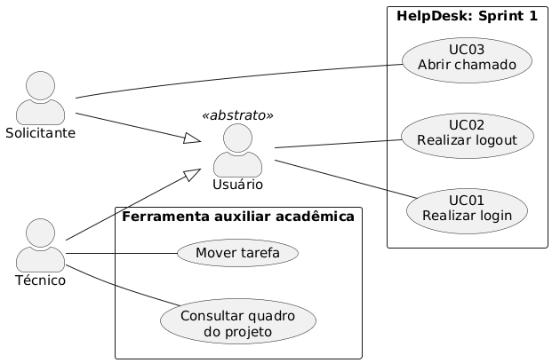
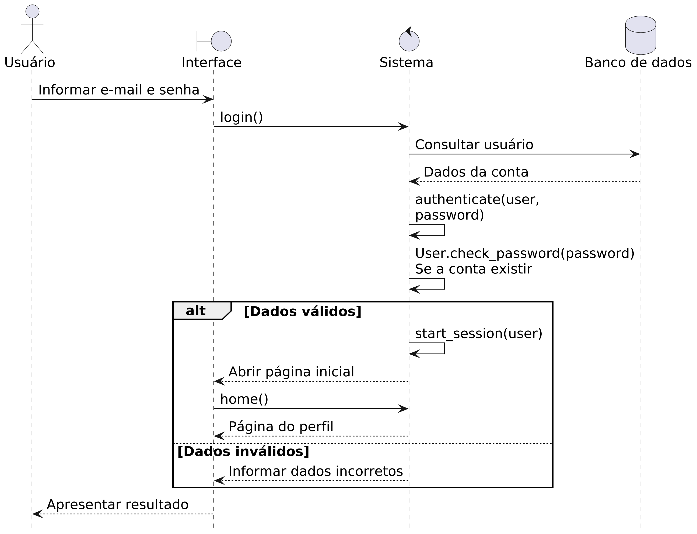
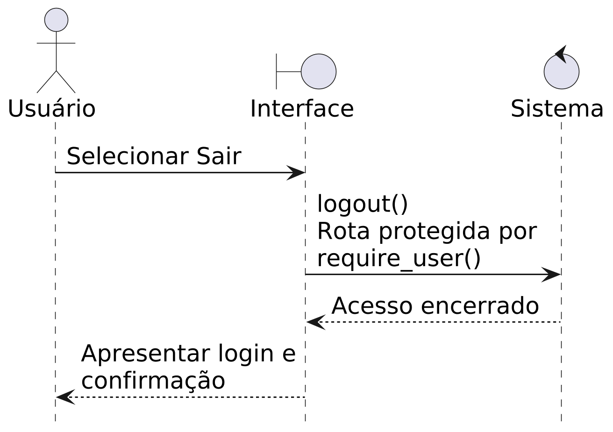
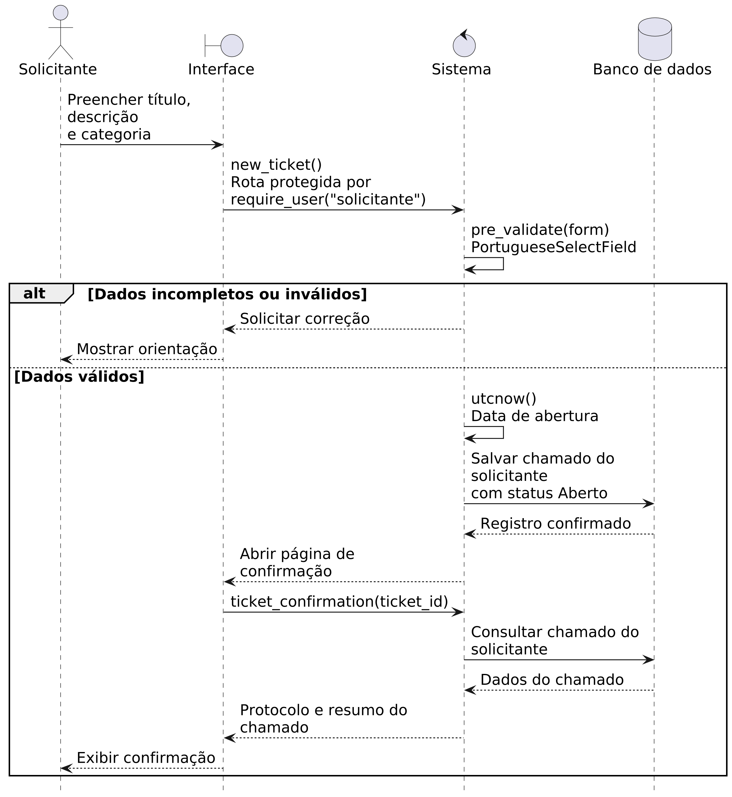

# HelpDesk: entrega da Sprint 1

Disciplina: Laboratório de Engenharia de Software\
Projeto: HelpDesk | Sistema de Controle de Chamados de TI\
Integrante: Leandro Pinzon Filho | Desenvolvimento individual\
Papel: Tech Lead e desenvolvedor responsável | Entrega: 29/10/2026\
Repositório: <https://github.com/Lfijho/chamadosLES>

## 1. Apresentação do projeto

Solicitações de suporte de TI dispersas dificultam o registro dos problemas e o acompanhamento do atendimento. O HelpDesk tem como objetivo centralizar esses pedidos, desde a abertura até a conclusão do chamado.

O sistema possui dois perfis. O solicitante registra problemas e poderá acompanhar os próprios chamados. O técnico será responsável pela consulta e pelo atendimento. Na Sprint 1, estão disponíveis a autenticação, a abertura de chamados e um Kanban auxiliar do desenvolvimento.

## 2. Equipe e organização

Leandro Pinzon Filho desenvolve o projeto individualmente, como Tech Lead e desenvolvedor responsável por requisitos, planejamento, implementação, documentação e apresentação. O trabalho foi dividido em três Sprints, e as tarefas são acompanhadas em um Kanban com as colunas Backlog, A fazer, Em andamento e Concluído.

## 3. Escopo e requisitos

| Código | Funcionalidade | Sprint |
|---|---|---|
| RF01 | Autenticar usuários | 1 |
| RF02 | Abrir chamado | 1 |
| RF03 | Consultar chamados | 2 |
| RF04 | Atualizar atendimento | 2 |
| RF05 | Registrar e consultar histórico | 3 |
| RF06 | Consultar painel de indicadores | 3 |

RF01 permite ao usuário entrar com e-mail e senha, acessar as funcionalidades do seu perfil e sair da conta.

RF02 permite ao solicitante registrar um problema de TI, informando título, descrição e categoria. Após o envio, o sistema apresenta o protocolo e a confirmação da abertura.

| Requisito não funcional | Descrição |
|---|---|
| Acesso e senhas | As páginas disponíveis dependem do perfil, e as senhas de autenticação são protegidas no cadastro |
| Persistência | Os dados são armazenados e preservados entre reinicializações da aplicação |
| Interface | Telas em português, validação dos formulários e adaptação a diferentes tamanhos de tela |
| Execução | A aplicação pode ser iniciada por Docker Compose com a configuração do projeto |

<!-- pagebreak -->

## 4. Funcionalidades desenvolvidas na Sprint 1

- Login com e-mail e senha e mensagem quando os dados são inválidos.
- Logout pelo botão Sair.
- Perfis de solicitante e técnico, com páginas e ações conforme o perfil.
- Abertura de chamado pelo solicitante, com título, descrição e categoria obrigatórios.
- Categorias Hardware, Software, Rede, Acessos e Outros.
- Geração de protocolo e atribuição do status inicial Aberto.
- Confirmação com o resumo do chamado, acessível ao solicitante que o abriu.
- Kanban auxiliar, no qual o técnico consulta e move as tarefas do desenvolvimento.

O Kanban acompanha tarefas do projeto, não o atendimento dos chamados. A consulta e a atualização dos chamados pelo técnico serão desenvolvidas na Sprint 2.

A aplicação utiliza Python com Flask, páginas em HTML/CSS e banco de dados SQLite. O Docker Compose reúne a configuração necessária para iniciar o sistema.

## 5. Especificações dos casos de uso

### UC01: realizar login

Ator: solicitante ou técnico. Objetivo: acessar as funcionalidades do perfil. Precondição: possuir uma conta de acesso.

1. O usuário acessa a página de login e informa e-mail e senha.
2. O sistema verifica os dados e permite o acesso às funcionalidades do perfil.
3. A interface apresenta a página inicial correspondente ao usuário.

Alternativa: se os dados forem inválidos ou algum campo obrigatório estiver vazio, o sistema informa o problema e permite uma nova tentativa.

Resultado esperado: o usuário acessa as funcionalidades disponíveis para seu perfil.

| Método/função | Classe ou módulo | Responsabilidade no caso de uso |
|---|---|---|
| `login()` | `helpdesk.routes` | Recebe os dados e coordena o acesso do usuário |
| `authenticate(user, password)` | `helpdesk.security` | Verifica as credenciais informadas |
| `check_password(password)` | `User`, em `helpdesk.models` | Confere a senha da conta |
| `start_session(user)` | `helpdesk.security` | Inicia o acesso autenticado |
| `home()` | `helpdesk.routes` | Apresenta a página inicial do perfil |

<!-- pagebreak -->

### UC02: realizar logout

Ator: solicitante ou técnico. Objetivo: sair da conta. Precondição: estar autenticado.

1. O usuário seleciona Sair.
2. O sistema encerra o acesso à conta.
3. A interface apresenta a página de login e confirma a saída.

Alternativa: se o acesso já tiver expirado, o usuário precisa entrar novamente para usar as páginas restritas.

Resultado esperado: o usuário sai da conta e precisa se autenticar para voltar às páginas restritas.

| Método/função | Classe ou módulo | Responsabilidade no caso de uso |
|---|---|---|
| `require_user()` | `helpdesk.security` | Exige autenticação para acessar a rota de saída |
| `logout()` | `helpdesk.routes` | Encerra o acesso e retorna à página de login |

### UC03: abrir chamado

Ator: solicitante. Objetivo: registrar um problema de TI. Precondição: estar autenticado como solicitante.

1. O solicitante seleciona Abrir chamado.
2. A interface apresenta o formulário de título, descrição e categoria.
3. O solicitante preenche os campos e envia a solicitação.
4. O sistema verifica os dados e registra o chamado em nome do solicitante.
5. A interface mostra a confirmação, o protocolo e o status Aberto.

Alternativas: se houver campos incompletos ou inválidos, o sistema solicita a correção antes de salvar. Um usuário com perfil técnico não pode abrir chamados nesta Sprint.

Resultado esperado: o chamado fica registrado e o solicitante recebe seu protocolo.

| Método/função | Classe ou módulo | Responsabilidade no caso de uso |
|---|---|---|
| `require_user("solicitante")` | `helpdesk.security` | Restringe a abertura ao perfil solicitante |
| `new_ticket()` | `helpdesk.routes` | Exibe o formulário e registra o chamado do solicitante |
| `pre_validate(form)` | `PortugueseSelectField`, em `helpdesk.forms` | Valida a categoria selecionada e orienta sua correção |
| `utcnow()` | `helpdesk.models` | Fornece a data e hora de abertura em UTC |
| `ticket_confirmation(ticket_id)` | `helpdesk.routes` | Confere o autor e apresenta protocolo e resumo |

<!-- pagebreak -->

## 6. Diagramas UML

### 6.1. Casos de uso

{width=16.5cm}

Solicitante e técnico podem entrar e sair da conta. O solicitante abre chamados, enquanto o técnico acessa o quadro de tarefas do projeto.

<!-- pagebreak -->

### 6.2. Sequência do login

{width=16.5cm}

O usuário informa suas credenciais, e o sistema verifica os dados antes de liberar as funcionalidades do perfil.

### 6.3. Sequência do logout

{width=13cm}

Ao selecionar Sair, o usuário encerra o acesso à conta e retorna à página de login.

<!-- pagebreak -->

### 6.4. Sequência da abertura de chamado

{width=16.5cm}

O solicitante preenche o formulário, e o sistema registra o chamado quando os dados são válidos. A interface apresenta o protocolo e a confirmação da abertura.

## 7. Execução e próximas Sprints

Na pasta do projeto, execute:

```bash
docker compose up -d
docker compose exec app flask demo-credentials
```

Acesse `http://localhost:8080`. O segundo comando permite consultar localmente as credenciais de demonstração dos perfis de solicitante e técnico.

A Sprint 2, com entrega em 12/11/2026, prevê consulta de chamados, filtros, definição de prioridade, atualização de status e registro da solução.

A Sprint 3, com entrega em 03/12/2026, prevê histórico de atendimento, painel de indicadores por status e prioridade, atualização da documentação e vídeo final.
