# HelpDesk: entrega da Sprint 2

Disciplina: Laboratório de Engenharia de Software\
Projeto: HelpDesk | Sistema de Controle de Chamados de TI\
Integrante: Leandro Pinzon Filho | Desenvolvimento individual\
Papel: Tech Lead e desenvolvedor responsável | Entrega: 12/11/2026\
Repositório: <https://github.com/Lfijho/chamadosLES>

## 1. Objetivo e organização

O HelpDesk centraliza solicitações de suporte de TI que, quando dispersas, dificultam o registro dos problemas e o acompanhamento do atendimento. O solicitante registra e consulta os próprios chamados. O técnico consulta as solicitações e conduz o atendimento até a conclusão.

Leandro Pinzon Filho desenvolve o projeto individualmente, como Tech Lead e responsável por requisitos, planejamento, implementação, testes, documentação e apresentação. O trabalho adota práticas de Scrum adaptadas ao desenvolvimento individual: backlog, planejamento em três Sprints, acompanhamento pelo Kanban e revisão e retrospectiva técnicas. O quadro usa as colunas Backlog, A fazer, Em andamento e Concluído e acompanha o desenvolvimento, separado do atendimento dos chamados.

A Sprint 1 entregou acesso e abertura de chamados. A Sprint 2 acrescenta consulta e atendimento e consolida a documentação com a modelagem UML corrigida. A entrega anterior permanece como registro histórico.

## 2. Escopo e requisitos

| Código | Funcionalidade | Sprint | Situação nesta entrega |
|---|---|---|---|
| RF01 | Autenticar usuários | 1 | Disponível |
| RF02 | Abrir chamado | 1 | Disponível |
| RF03 | Consultar chamados | 2 | Disponível |
| RF04 | Atualizar atendimento | 2 | Disponível |
| RF05 | Registrar e consultar histórico | 3 | Backlog |
| RF06 | Consultar painel de indicadores | 3 | Backlog |

| Código | Requisito não funcional |
|---|---|
| RNF13 | Restringir consultas e alterações conforme o perfil e a propriedade do chamado |
| RNF03 | Proteger as senhas e exigir autenticação para acessar as páginas restritas |
| RNF07 | Preservar dados entre reinicializações e na atualização da Sprint 1 para a Sprint 2 |
| RNF09 | Oferecer telas em português, labels, foco de teclado e adaptação a diferentes telas |
| RNF04 | Validar formulários no servidor e proteger as operações que alteram dados |
| RNF01 | Permitir inicialização pelo Docker Compose com a configuração do projeto |

<!-- pagebreak -->

## 3. Funcionalidades e regras de atendimento

A aplicação utiliza Python com Flask, páginas HTML/CSS e SQLite, com execução por Docker Compose. A Sprint 1 oferece login por e-mail e senha, logout e abertura de chamado. Título tem de 5 a 120 caracteres; descrição, de 10 a 5.000. As categorias são Hardware, Software, Rede, Acessos e Outros. A abertura gera protocolo e confirmação em nome do solicitante autenticado.

A Sprint 2 permite consultar chamados, combinar filtros de status e categoria e navegar por páginas de dez registros, dos mais recentes para os mais antigos. O solicitante vê somente os próprios chamados; o técnico vê todos. O detalhe apresenta protocolo, título, descrição, categoria, solicitante, abertura, status, prioridade e solução quando existente.

As regras de atendimento são:

- Somente o técnico pode alterar prioridade, status ou solução.
- A prioridade é Baixa, Média ou Alta. Chamados novos e os preservados da Sprint 1 recebem Média inicialmente.
- O fluxo é Aberto → Em atendimento → Concluído. Concluído é terminal e fica disponível para consulta.
- A conclusão exige solução com 1 a 5.000 caracteres após remover espaços externos, além da data de conclusão em UTC.
- Alterações inválidas preservam os dados anteriores. Se o chamado mudou desde a abertura da página, o técnico precisa revisar os dados atualizados.
- Cada mudança de status grava autor, data UTC e valores anterior e novo junto com a alteração do chamado. A interface de histórico fica para a Sprint 3.

## 4. Casos de uso e funções envolvidas

UC01, UC02 e UC03 pertencem à Sprint 1. UC04, UC05, UC06 e UC07 foram acrescentados na Sprint 2. As tabelas identificam funções implementadas no projeto. Funções de módulo estão indicadas pelo nome do módulo, sem atribuição a uma classe de controller. Nas sequências, validate() e validate_on_submit() são operações herdadas de FlaskForm.

### UC01: realizar login

Ator: solicitante ou técnico. Objetivo: acessar as funções do perfil. Precondição: possuir uma conta.

1. O usuário informa e-mail e senha.
2. O sistema verifica os dados.
3. O sistema permite o acesso e apresenta a página inicial do perfil.

Alternativas: dados inválidos mantêm o formulário para uma nova tentativa. Campos incompletos recebem orientação. Após tentativas repetidas, o sistema solicita que o usuário aguarde.

Pós-condição: o usuário acessa as funções do próprio perfil quando a autenticação é aceita.

| Método/função real | Classe ou módulo | Responsabilidade |
|---|---|---|
| `login` | `helpdesk.routes` | Coordenar o acesso |
| `authenticate` | `helpdesk.security` | Verificar as credenciais |
| `check_password` | `User`, em `helpdesk.models` | Conferir a senha da conta |
| `start_session` | `helpdesk.security` | Iniciar o acesso autenticado |

<!-- pagebreak -->

### UC02: realizar logout

Ator: solicitante ou técnico. Objetivo: sair da conta. Precondição: estar autenticado.

1. O usuário seleciona Sair.
2. O sistema encerra o acesso atual.
3. A página de login apresenta a confirmação da saída.

Alternativa: se o acesso já expirou, o sistema solicita novo login para acessar as páginas restritas.

Pós-condição: o usuário precisa se autenticar novamente para voltar às funções restritas.

| Método/função real | Classe ou módulo | Responsabilidade |
|---|---|---|
| `logout` | `helpdesk.routes` | Encerrar o acesso e retornar ao login |
| `login` | `helpdesk.routes` | Apresentar o formulário após a saída |

### UC03: abrir chamado

Ator: solicitante. Objetivo: registrar um problema de TI. Precondição: estar autenticado como solicitante.

1. O solicitante seleciona Abrir chamado.
2. O solicitante informa título, descrição e categoria e envia o formulário.
3. O sistema valida os dados e registra o chamado em nome do solicitante.
4. O sistema apresenta a confirmação, o protocolo e o status Aberto. O chamado recebe prioridade Média.

Alternativas: campos inválidos recebem orientação antes de salvar. O técnico não pode abrir chamados. A confirmação anterior continua acessível ao autor.

Pós-condição: o chamado fica registrado e disponível na consulta do solicitante e do técnico.

| Método/função real | Classe ou módulo | Responsabilidade |
|---|---|---|
| `new_ticket` | `helpdesk.routes` | Receber e validar o formulário |
| `create_ticket` | `helpdesk.tickets` | Registrar o chamado do solicitante |
| `ticket_confirmation` | `helpdesk.routes` | Apresentar a confirmação privada |
| `get_ticket` | `helpdesk.tickets` | Buscar o chamado com permissão de consulta |
| `visible_tickets` | `helpdesk.tickets` | Restringir a confirmação ao solicitante |

<!-- pagebreak -->

### UC04: consultar chamados e filtrar

Ator: solicitante ou técnico. Objetivo: localizar solicitações. Precondição: estar autenticado.

1. O usuário acessa Meus chamados ou Chamados, conforme o perfil.
2. O sistema lista os registros que o usuário pode consultar.
3. O usuário combina status e categoria, aplica ou limpa os filtros.
4. O usuário navega entre as páginas, mantendo os filtros escolhidos.

Alternativas: lista vazia orienta o próximo passo; busca sem resultados permite alterar ou limpar os filtros. Parâmetros inválidos recebem orientação. Página inexistente informa que o recurso não foi encontrado.

Pós-condição: a consulta mantém a visibilidade do perfil, inclusive ao alterar parâmetros.

| Método/função real | Classe ou módulo | Responsabilidade |
|---|---|---|
| `ticket_list` | `helpdesk.routes` | Validar os parâmetros e apresentar a consulta |
| `visible_tickets` | `helpdesk.tickets` | Restringir registros conforme o perfil |
| `list_tickets` | `helpdesk.tickets` | Aplicar filtros, ordenação e paginação |

### UC05: consultar detalhes

Ator: solicitante ou técnico. Objetivo: consultar os dados de um chamado. Precondição: estar autenticado e ter permissão sobre o registro.

1. O usuário seleciona um chamado na lista.
2. O sistema verifica a permissão e busca os dados.
3. O sistema apresenta o detalhe e as ações permitidas ao perfil.

Alternativas: chamado inexistente ou não visível ao usuário atual não é exibido, inclusive por acesso direto ao endereço. O técnico pode consultar chamados de qualquer solicitante. Chamados concluídos apresentam a solução e não oferecem edição.

Pós-condição: o usuário consulta o chamado sem modificar seus dados.

| Método/função real | Classe ou módulo | Responsabilidade |
|---|---|---|
| `ticket_detail` | `helpdesk.routes` | Coordenar a abertura do detalhe |
| `get_ticket` | `helpdesk.tickets` | Buscar somente um registro autorizado |
| `visible_tickets` | `helpdesk.tickets` | Aplicar a visibilidade do perfil |
| `ticket_detail_response` | `helpdesk.routes` | Apresentar os dados e as ações disponíveis |

<!-- pagebreak -->

### UC06: definir prioridade

Ator: técnico. Objetivo: organizar a prioridade do atendimento. Precondições: estar autenticado como técnico e consultar um chamado não concluído.

1. O técnico seleciona Baixa, Média ou Alta no detalhe.
2. O técnico seleciona Salvar prioridade.
3. O sistema valida a alteração e apresenta a confirmação.

Alternativas: prioridade inválida é rejeitada. Solicitante não pode realizar a alteração. Chamado concluído permanece sem edição. Se os dados mudaram, o sistema solicita revisão da página atualizada.

Pós-condição: a prioridade válida fica persistida; uma rejeição mantém os dados anteriores.

| Método/função real | Classe ou módulo | Responsabilidade |
|---|---|---|
| `ticket_priority` | `helpdesk.routes` | Coordenar a alteração da prioridade |
| `get_ticket` | `helpdesk.tickets` | Buscar o chamado autorizado |
| `ticket_detail_response` | `helpdesk.routes` | Apresentar o detalhe em caso de rejeição |
| `update_priority` | `helpdesk.tickets` | Coordenar a gravação autorizada |
| `check_edit` | `helpdesk.tickets` | Verificar perfil, versão e estado do chamado |
| `set_priority` | `Ticket`, em `helpdesk.models` | Validar e atribuir a prioridade |

<!-- pagebreak -->

### UC07: atualizar status e registrar solução

Ator: técnico. Objetivo: conduzir e concluir o atendimento. Precondições: estar autenticado como técnico e consultar um chamado não concluído.

1. O técnico seleciona Iniciar atendimento para um chamado Aberto e envia essa ação.
2. O sistema registra Em atendimento e confirma a alteração.
3. Mais tarde, o técnico informa a solução e envia uma nova ação: Concluir chamado.
4. O sistema valida a solução, registra Concluído e a data de conclusão e apresenta a confirmação.

Iniciar e concluir são ações separadas. Cada envio solicita somente a próxima transição permitida.

Alternativas: solução vazia, composta apenas por espaços ou acima do limite exige correção. Saltos, retrocessos, alterações em chamados concluídos e operações do solicitante são rejeitados. Em conflito ou falha de gravação, a operação não confirma alterações parciais.

Pós-condição: a mudança de status e seu evento com autoria e data UTC ficam persistidos juntos. Após a conclusão, o chamado permanece disponível para consulta.

| Método/função real | Classe ou módulo | Responsabilidade |
|---|---|---|
| `ticket_status` | `helpdesk.routes` | Coordenar uma transição por requisição |
| `get_ticket` | `helpdesk.tickets` | Buscar o chamado autorizado |
| `validate_solution` | `StatusForm`, em `helpdesk.forms` | Exigir conteúdo na solução ao concluir |
| `ticket_detail_response` | `helpdesk.routes` | Apresentar o detalhe em caso de rejeição |
| `check_edit` | `helpdesk.tickets` | Verificar perfil, versão e estado do chamado |
| `update_status` | `helpdesk.tickets` | Gravar a mudança e o evento juntos |
| `change_status` | `Ticket`, em `helpdesk.models` | Validar a transição e atribuir solução e conclusão |

<!-- pagebreak -->

## 5. Modelagem UML

### 5.1. Casos de uso

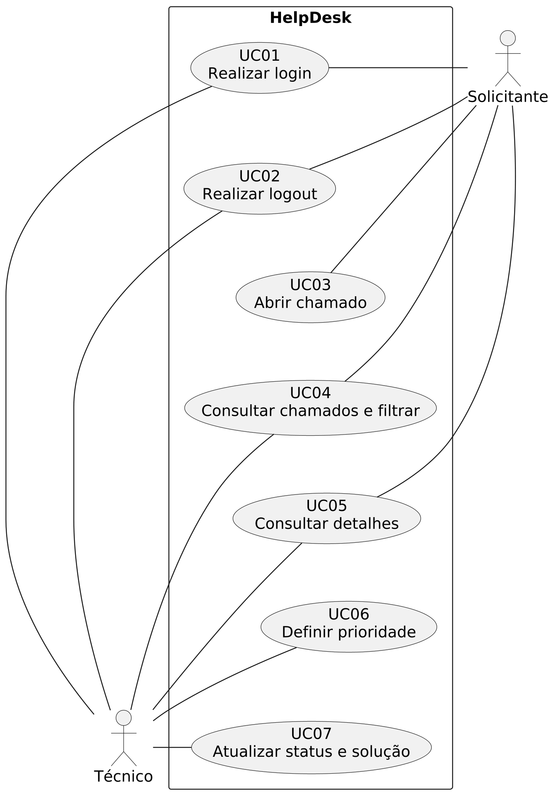{width=16.5cm height=21cm}

Solicitante e Técnico estão diretamente associados às ações disponíveis dentro do limite HelpDesk. UC04 a UC07 foram acrescentados nesta entrega; o Kanban acompanha o desenvolvimento e fica fora deste diagrama funcional.

<!-- landscape -->

### 5.2. Sequência do login

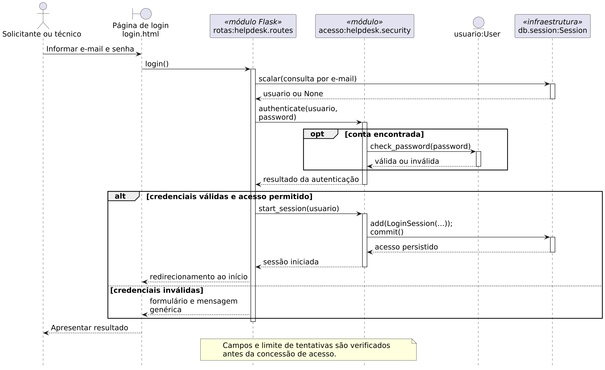{width=26cm height=15cm}

O módulo de rotas coordena a autenticação com o módulo de acesso e o objeto User. A persistência participa da consulta e do registro do acesso autorizado.

<!-- pagebreak -->

### 5.3. Sequência do logout

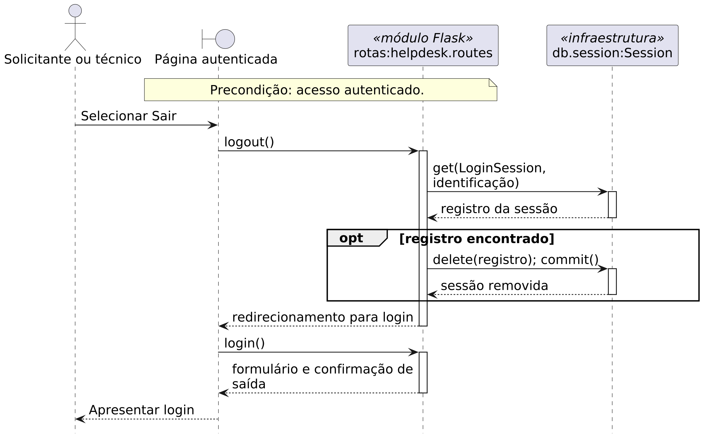{width=24cm height=15cm}

A saída remove o acesso atual e retorna à página de login. A condição de acesso autenticado antecede a execução da rota.

<!-- pagebreak -->

### 5.4. Sequência da abertura de chamado

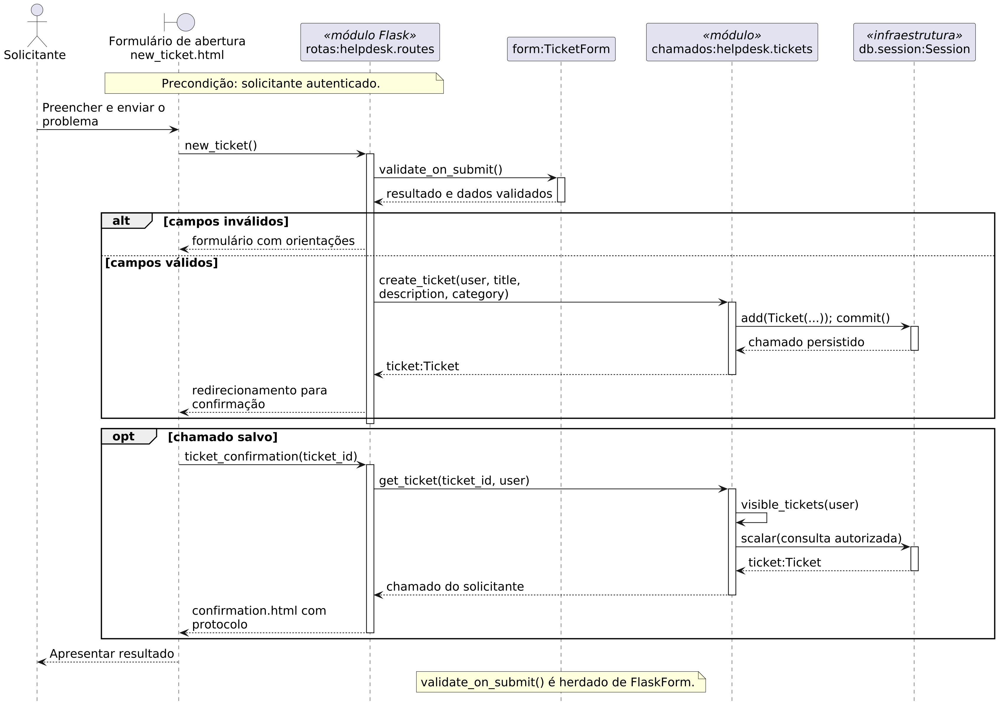{width=26cm height=15cm}

O formulário valida os campos, e as funções do módulo de chamados registram a solicitação. A consulta autorizada fornece os dados da confirmação ao solicitante.

<!-- pagebreak -->

### 5.5. Sequência da consulta e dos filtros

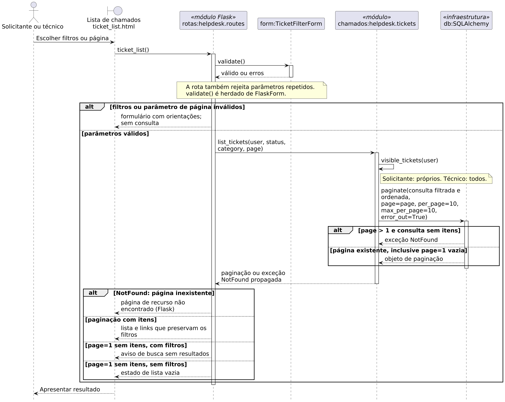{width=26cm height=15cm}

A consulta restringe os registros pelo perfil antes de aplicar filtros e paginação. A primeira página aceita consulta vazia; filtros inválidos impedem a consulta, e uma página além dos resultados é tratada como inexistente.

<!-- pagebreak -->

### 5.6. Sequência da consulta de detalhes

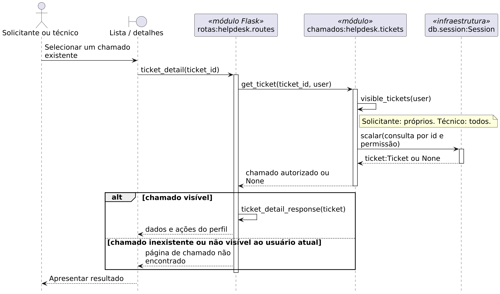{width=26cm height=15cm}

A busca considera a permissão do usuário junto com a identificação do chamado. Um registro não autorizado não é apresentado.

<!-- pagebreak -->

### 5.7. Sequência da prioridade

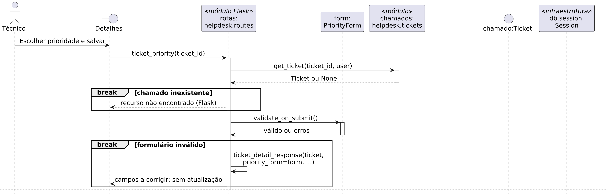{width=26cm height=15cm}

A busca autorizada antecede a validação do formulário e a atualização.

<!-- pagebreak -->

### 5.7. Sequência da prioridade (continuação)

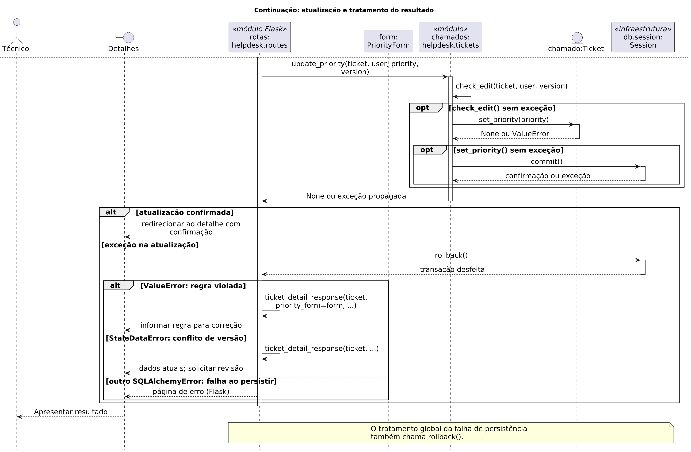{width=26cm height=15cm}

Regra violada, conflito e falha de persistência acionam rollback() na rota; chamado ausente e formulário inválido não passam por essa operação.

<!-- pagebreak -->

### 5.8. Sequência do status e da solução

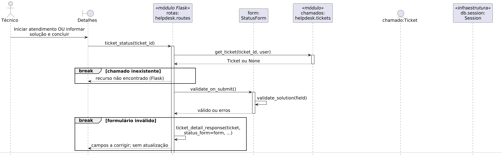{width=26cm height=15cm}

Cada requisição executa uma única transição, após a busca e a validação do formulário.

<!-- pagebreak -->

### 5.8. Sequência do status e da solução (continuação)

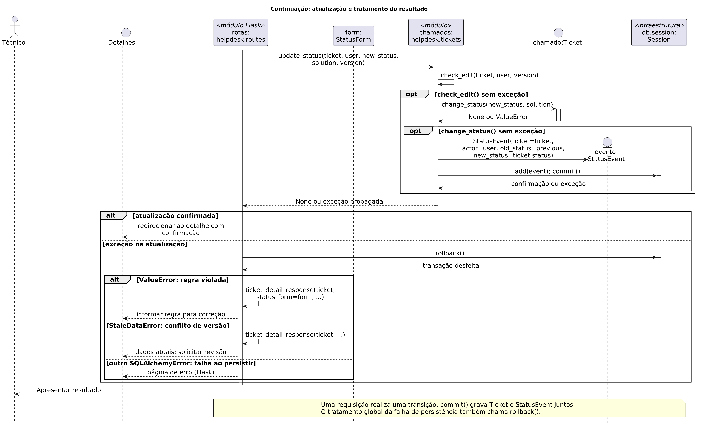{width=26cm height=15cm}

A alteração do Ticket e o StatusEvent são gravados na mesma transação; erros impedem a confirmação parcial.

<!-- pagebreak -->

### 5.9. Classes e operações

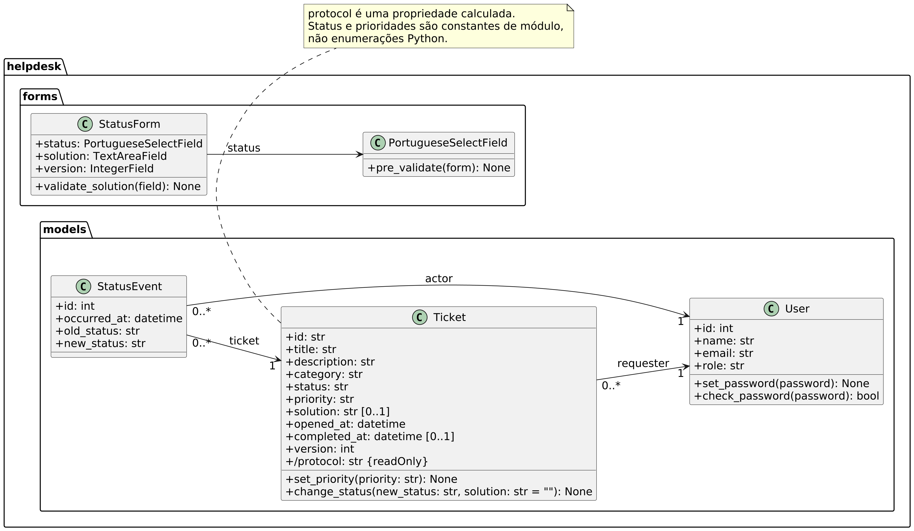{width=26cm height=14.5cm}

As associações mostram o solicitante do chamado e o autor de cada evento. O sinal + identifica membros públicos; protocol é uma propriedade calculada, e a herança de infraestrutura foi omitida.

<!-- portrait -->

### 5.10. Atividades do atendimento

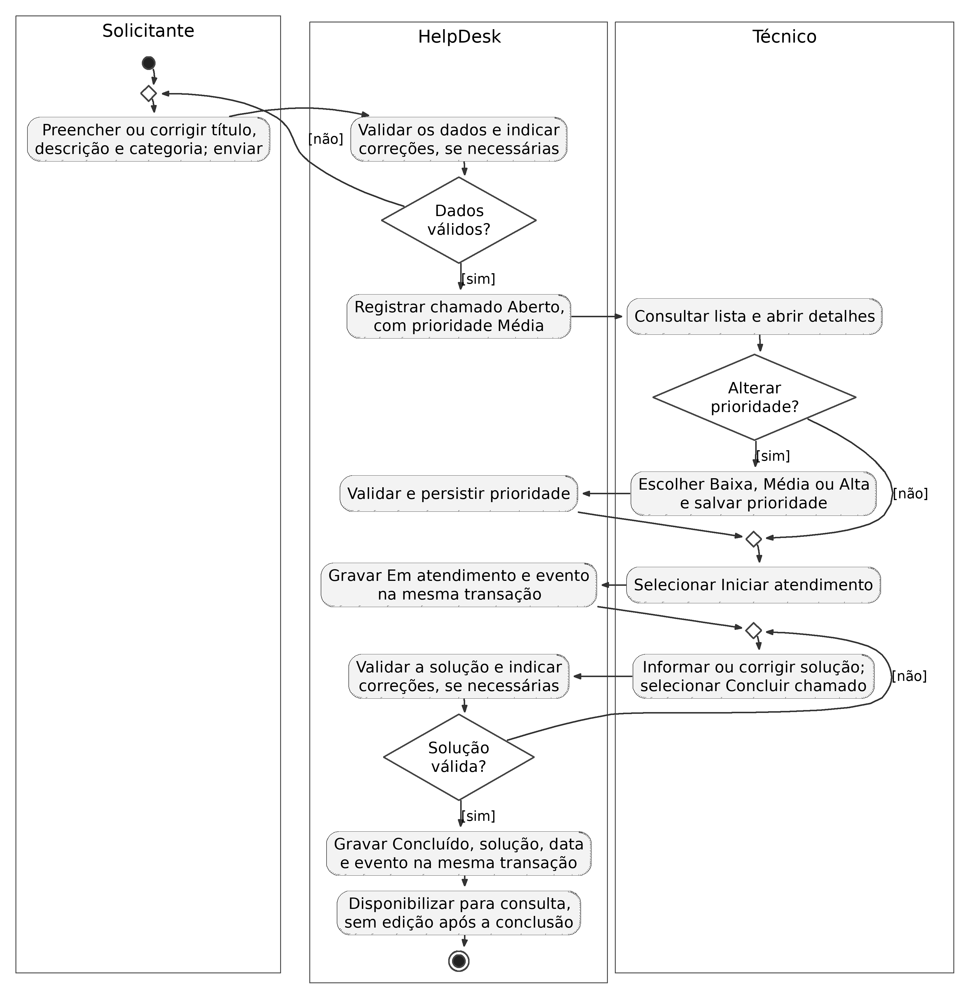{width=16.5cm height=20cm}

## 6. Execução

Na pasta do projeto, execute:

```bash
docker compose up -d
docker compose exec app flask demo-credentials
```

Acesso: `http://localhost:8080`. O segundo comando exibe as credenciais de demonstração. Para atualizar a imagem, execute `docker compose up -d --build`.

## 7. Próxima Sprint

Sprint 3 (03/12/2026): anotações e consulta cronológica do histórico, indicadores por status e prioridade, documentação e vídeo final. O histórico aproveitará os eventos automáticos desta Sprint.
