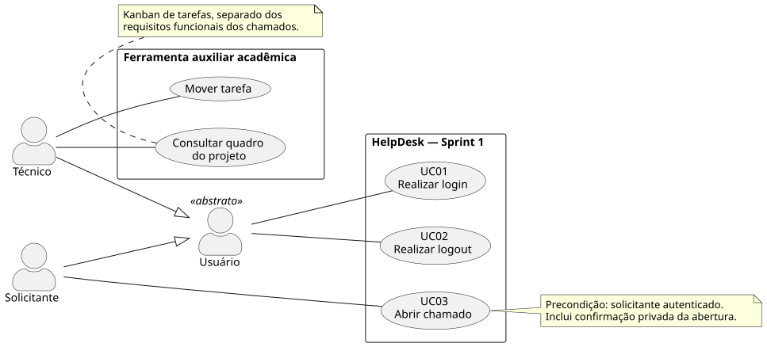
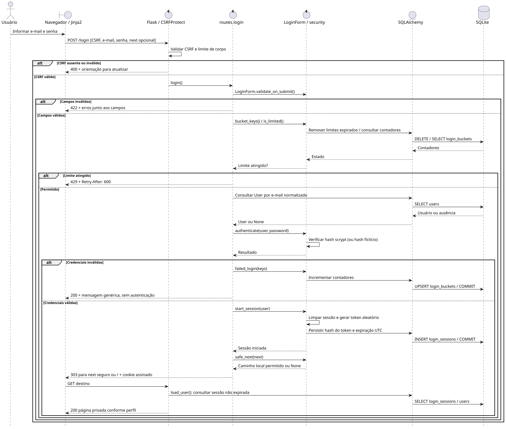
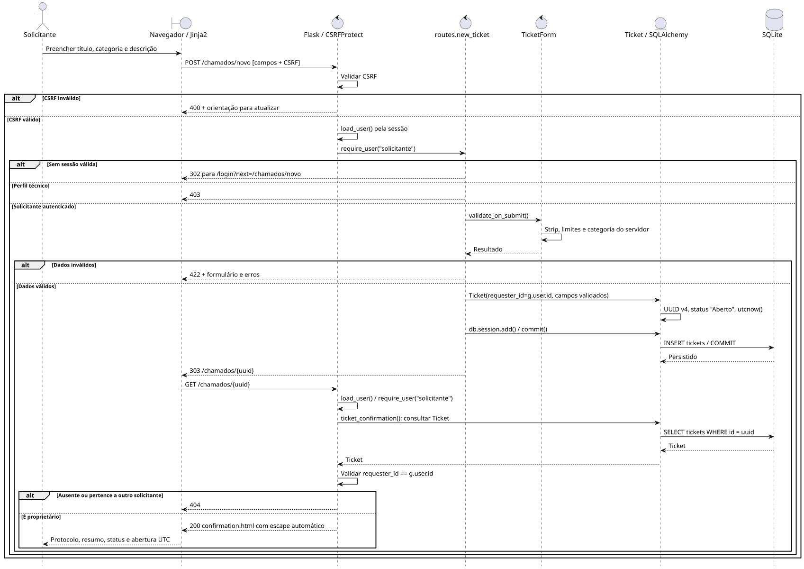
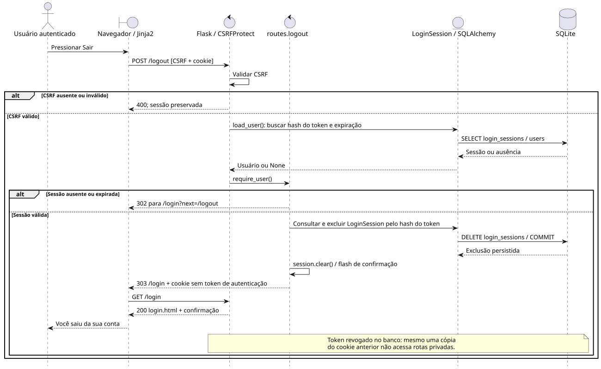

# Sprint 1 — HelpDesk

## Identificação e objetivo

**Disciplina:** Laboratório de Engenharia de Software. **Integrante e responsável:** Leandro Pinzon Filho. **Desenvolvimento:** individual. **Entrega prevista:** 29/10/2026.

O HelpDesk centraliza solicitações de suporte de TI em uma aplicação web. O solicitante registra um problema; o técnico organizará seu atendimento nas próximas Sprints. O objetivo desta Sprint é entregar acesso autenticado e registro persistente de chamados, com confirmação privada, em um ambiente local reproduzível.

## Organização individual e práticas de SCRUM

Leandro atua como Tech Lead, responsável por requisitos, planejamento, arquitetura, desenvolvimento, testes, infraestrutura, documentação e apresentação. Tech Lead é uma responsabilidade técnica, não um papel oficial do SCRUM. O desenvolvimento individual utiliza backlog, planejamento por Sprint, acompanhamento de tarefas e revisão por testes e inspeção; não constitui uma equipe SCRUM completa. Não há registro formal de retrospectiva ou de cerimônias realizadas nas fontes consultadas.

O Product Backlog define evolução; o Sprint Backlog decompõe o trabalho em tarefas verificáveis; o incremento é validado por testes, demonstração e revisão. `docs/kanban.md` registra o que foi verificado na entrega, sem inventar reuniões ou datas de execução. O quadro na aplicação permite acompanhar o estado operacional; divergências posteriores são possíveis, pois o documento é um registro versionado.

## Escopo e Product Backlog

| Código | Funcionalidade | Sprint | Critério de aceite do produto | Entrega atual |
|---|---|---|---|---|
| RF01 | Autenticar usuários | 1 | Login de ambos os perfis, logout POST, rotas privadas e sessão revogável | Implementado |
| RF02 | Abrir chamado | 1 | Solicitante válido registra dados com protocolo, autor da sessão, Aberto e UTC | Implementado |
| RF03 | Consultar chamados | 2 | Listagem e filtros respeitam permissões de solicitante e técnico | Backlog |
| RF04 | Gerenciar atendimento | 2 | Atualizar prioridade/status e exigir solução para encerrar | Backlog |
| RF05 | Registrar e consultar histórico | 3 | Registrar e consultar ações de atendimento segundo permissões | Backlog |
| RF06 | Consultar indicadores | 3 | Consultar indicadores calculados a partir de dados persistidos | Backlog |

A confirmação mínima de RF02 não é a listagem de RF03. Fora desta Sprint: filtros, atendimento, mudanças de prioridade/status, encerramento, histórico, indicadores, cadastro público, recuperação de senha, administração de usuários e gestão avançada de projeto.

## Sprint Backlog

O catálogo completo e importável está em [backlog.yml](backlog.yml). IDs, prioridade e critérios são exibidos no quadro. As tarefas futuras começam em Backlog; a coluna operacional já persistida prevalece sobre o catálogo nas sincronizações.

| ID | Entrega | Prioridade | Critério de aceite |
|---|---|---|---|
| S1-01 | Autenticação e permissões | Alta | Dois perfis, logout/CSRF, sessão e bloqueios verificados em banco isolado |
| S1-02 | Abrir chamado | Alta | Validações, autor, status, UTC, protocolo, PRG e propriedade testados |
| S1-03 | Interface | Alta | Navegador desktop/celular; labels e foco verificados |
| S1-04 | Kanban auxiliar | Média | Técnico altera coluna com CSRF; permissão e idempotência testadas |
| S1-05 | Docker e dados | Alta | Inicialização automática, healthcheck e persistência após recriação |
| S1-06 | Testes e CI | Alta | Suíte passa; workflow versionado testa e valida Compose |
| S1-07 | Documentação | Média | Requisitos, regras, três casos de uso, SCRUM e demonstração coerentes |
| S1-08 | UML | Média | Quatro fontes, SVG/PNG renderizados e inspecionados |

## Requisitos funcionais da entrega

**RF01 — Autenticar usuários.** E-mail (obrigatório, formato válido, até 254 caracteres, normalizado para minúsculas) e senha (obrigatória, até 128 caracteres). Credencial incorreta retorna mensagem genérica; dados malformados retornam erros de campo. Perfis solicitante/técnico são validados no servidor. Logout é exclusivamente POST com CSRF e revoga a sessão persistida. Não existe cadastro público.

**RF02 — Abrir chamado.** Apenas solicitante autenticado. Título entre 5 e 120 caracteres e descrição entre 10 e 5.000, removendo espaços externos antes de validar. Categoria obrigatória pertence a Hardware, Software, Rede, Acessos ou Outros. UUID v4 único, prefixo de protocolo HD-, associação a `g.user.id`, status Aberto e data/hora UTC são definidos no servidor. Após COMMIT, redirecionar (303) para GET de confirmação; proprietário validado a cada acesso.

## Requisitos não funcionais verificáveis

| Código | Requisito | Verificação |
|---|---|---|
| RNF01 | Inicializar de clone limpo com Docker/Compose, sem dependências manuais no host, em localhost:8080 | Build, `up -d` e GET /healthz |
| RNF02 | Processo Gunicorn sem root e sem debug, com sinais encaminhados | Dockerfile, `id` no container, logs de inicialização/recriação |
| RNF03 | Hash scrypt para senhas; chave aleatória persistida ou configurada, sem segredo fixo versionado | Testes de hash/chave/modo 0600 e revisão Git |
| RNF04 | CSRF em todos os POSTs, escape automático e validação no servidor | Testes sem/token inválido, XSS e limites |
| RNF05 | Cookie HttpOnly/SameSite=Lax; expiração absoluta de 8h, também validada no banco | Teste de cookie e sessão expirada; configuração |
| RNF06 | Após 5 falhas por conta ou 30 por IP em janela fixa de 10min, login retorna 429 até expirar | Testes de limite de conta/IP e expiração; SQLite persiste contadores |
| RNF07 | Dados, chave e contas preservados ao recriar containers sem remover volume | Verificação de persistência isolada e seed repetido |
| RNF08 | SQLite evolui com migração versionada e inicialização interrompe antes do Gunicorn se upgrade falhar | Alembic upgrade/check e teste do entrypoint com revisão inválida |
| RNF09 | Interface pt-BR, labels associados, foco visível, alvos de 44px, layouts sem overflow em 320/390/768/1440px | Revisão CSS, navegador, teclado e axe; sem afirmar certificação WCAG |
| RNF10 | Recursos essenciais servidos localmente, sem CDN ou JavaScript necessário | Revisão de templates/CSP e fluxo no navegador |
| RNF11 | Testes usam banco/estado temporário e CI sem segredos | Fixtures e workflow versionado |
| RNF12 | Healthcheck consulta esquema/tabelas; logs operacionais sem formulário/senha/cookie/query string | Teste de indisponibilidade, configuração de logs e revisão |

Não há promessa de latência ou capacidade sem medição. Esta entrega não mede carga ou alta disponibilidade.

## Regras de negócio

- **RN01:** somente contas provisionadas acessam a aplicação; perfil vem do banco, nunca do formulário.
- **RN02:** solicitante abre chamados; técnico recebe 403 ao tentar abrir, mesmo por POST direto com CSRF válido.
- **RN03:** identidade do autor, status e abertura são atribuídos pelo servidor; campos extras enviados pelo cliente não os alteram.
- **RN04:** categoria é validada pela lista fechada do servidor e por restrição no banco.
- **RN05:** conteúdo é texto; HTML enviado é mostrado com escape, não executado.
- **RN06:** confirmação só é visível ao autor solicitante autenticado; ausente ou de outro autor responde 404, sem revelar existência.
- **RN07:** atualização do GET de confirmação não repete o POST de abertura. Um novo envio explícito é uma nova solicitação; não há deduplicação semântica.
- **RN08:** chamado inicia em Aberto; alterações de atendimento não existem nesta Sprint.
- **RN09:** data sem offset no SQLite tem semântica UTC; visualização identifica UTC.
- **RN10:** tarefa Kanban não é chamado e suas colunas não representam estados de atendimento.
- **RN11:** sincronização insere tarefas ausentes e atualiza metadados, sem apagar extras ou sobrescrever coluna. Contas existentes não têm senha redefinida.
- **RN12:** logout revoga somente a sessão atual; token anterior copiado deixa de autenticar. Outras sessões do mesmo usuário permanecem válidas até seu logout/expiração.

## UC01 — Realizar login

**Ator:** solicitante ou técnico (especializações de Usuário). **Objetivo:** acessar as funções do próprio perfil. **Precondições:** conta provisionada; aplicação e banco disponíveis; formulário atual com token CSRF.

**Fluxo principal:**

1. Ator acessa GET `/login`.
2. Sistema exibe formulário com labels e CSRF.
3. Ator informa e-mail e senha e envia POST `/login`.
4. Sistema valida CSRF, tamanho do corpo, formato e limites dos campos; normaliza e-mail.
5. Sistema verifica contadores persistidos e consulta a conta por e-mail.
6. Sistema verifica hash scrypt, limpa o contador da conta e cria sessão revogável com expiração UTC.
7. Sistema responde 303 para caminho local permitido em `next`, ou `/`.
8. Navegador faz GET; sistema consulta a sessão e exibe página apropriada ao perfil.

**Fluxos alternativos:** A1: usuário já autenticado acessa `/login`, sistema redireciona para `/`. A2: credenciais inválidas, incrementa contadores e mostra “E-mail ou senha inválidos.” sem autenticar (200). A3: caminho de retorno externo, desconhecido ou ambíguo é ignorado, retornando `/`.

**Exceções:** E1: CSRF ausente/expirado/inválido, resposta 400 e orientação para atualizar. E2: campos inválidos, 422 e erros específicos sem autenticar. E3: limite atingido, 429 e Retry-After de 600 segundos; pode tentar após a janela fixa de até 10 minutos. E4: corpo acima de 32 KiB, 413. E5: falha não tratável do banco, 500 genérico, sem acesso concedido; rollback da sessão ORM. **Pós-condições:** sucesso cria cookie assinado com token e registro de hash/expiração no banco; falha não autentica.

## UC02 — Realizar logout

**Ator:** solicitante ou técnico autenticado. **Objetivo:** encerrar o acesso nesta sessão. **Precondições:** sessão válida e CSRF disponível.

**Fluxo principal:**

1. Ator pressiona “Sair” na navegação.
2. Navegador envia POST `/logout` com CSRF e cookie.
3. Sistema valida token e sessão.
4. Sistema exclui `LoginSession` correspondente ao hash do token e confirma a transação.
5. Sistema limpa dados de autenticação do cookie e registra mensagem de saída.
6. Responde 303 `/login`; GET mostra a confirmação.

**Fluxos alternativos:** A1: sem sessão válida, após CSRF válido redireciona ao login; `next=/logout` não é aceito como destino pós-login. A2: nova tentativa de acessar rota privada exige login, inclusive reutilizando cookie anterior.

**Exceções:** E1: GET `/logout` retorna 405. E2: CSRF inválido retorna 400 e não executa logout. E3: falha no banco retorna 500 genérico; usuário deve tentar novamente, pois revogação não foi confirmada. **Pós-condições:** sessão atual revogada; outras sessões não são alteradas. O cookie pode permanecer para mensagem/CSRF, sem token autenticador.

## UC03 — Abrir chamado

**Ator:** solicitante. **Objetivo:** registrar problema de TI e receber protocolo. **Precondições:** solicitante autenticado, banco disponível e formulário com CSRF.

**Fluxo principal:**

1. Ator acessa GET `/chamados/novo` pela navegação.
2. Sistema valida perfil e mostra campos e categorias do servidor.
3. Ator preenche título, categoria e descrição e envia POST.
4. Sistema valida CSRF, sessão, perfil, limites e categoria; remove espaços externos.
5. Sistema cria `Ticket` com campos validados e `requester_id=g.user.id`; gera UUID v4, status Aberto e UTC.
6. Sistema persiste no SQLite e confirma a transação.
7. Sistema responde 303 `/chamados/{uuid}`.
8. Navegador solicita GET; sistema valida novamente sessão/perfil e propriedade.
9. Sistema mostra confirmação, protocolo, título, categoria, descrição, status e data UTC com escape automático.

**Fluxos alternativos:** A1: campo vazio, curto, longo ou categoria inexistente retorna 422, preservando dados para correção. A2: cancelar retorna ao início sem salvar. A3: atualizar confirmação repete apenas GET. A4: abrir outro chamado inicia um formulário novo.

**Exceções:** E1: sem autenticação em GET, 302 para login com caminho de retorno seguro; POST sem CSRF é rejeitado antes disso. E2: técnico autenticado recebe 403. E3: CSRF inválido, 400. E4: corpo acima de 32 KiB, 413. E5: confirmação ausente/de outro solicitante, 404. E6: erro de persistência, 500 genérico e rollback; não há confirmação de sucesso. **Pós-condições:** sucesso cria um chamado único pertencente ao ator; erro de validação não cria registro.

## Kanban auxiliar

**KA01:** técnico consulta tarefas com ID, título, Sprint, prioridade e critério de aceite. **KA02:** técnico muda coluna por seletor e botão acessíveis; POST com CSRF e lista fechada, seguido de redirecionamento. **KA03:** SQLite persiste as colunas; catálogo versionado é sincronizado de forma idempotente. Solicitante não tem link nem acesso direto autorizado. Não há responsáveis múltiplos, comentários, anexos ou drag-and-drop. KA01–KA03 não ampliam RF01–RF06.

## Camadas e diagramas

Application factory configura Flask e extensões. CSRFProtect valida POST antes das rotas; `load_user()` resolve sessão/usuário, `require_user()` autoriza, Forms validam campos e rotas coordenam SQLAlchemy e templates. Datas padrão e UUID são atribuídos no INSERT. Migração inicial: `3c65b6acc942`.

Os participantes ORM/SQLite nos diagramas condensam consultas relacionadas; os nomes de rotas/funções correspondem ao código. Falhas de infraestrutura retornam erro genérico e não são expandidas em todos os fragmentos para manter legibilidade. Não são modeladas funções futuras como implementadas.

PlantUML foi adotado no lugar de diagrams.net para versionar e reproduzir os desenhos. Fontes e imagens em `docs/diagrams/`; renderização: `./scripts/render-diagrams.sh`.

### Casos de uso da Sprint 1

[PNG](diagrams/use-cases.png) · [Fonte PlantUML](diagrams/use-cases.puml)

### Sequência do login

[PNG](diagrams/login.png) · [Fonte PlantUML](diagrams/login.puml)

### Sequência da abertura

[PNG](diagrams/open-ticket.png) · [Fonte PlantUML](diagrams/open-ticket.puml)

### Sequência do logout

[PNG](diagrams/logout.png) · [Fonte PlantUML](diagrams/logout.puml)

## Validação e demonstração

Comandos de execução, testes, renderização e roteiro para o professor estão no [README](../README.md). Evidências executadas e limitações reais estão em [verificacoes.md](verificacoes.md). O estado de conclusão por tarefa está em [kanban.md](kanban.md); RF03–RF06 permanecem futuros.
